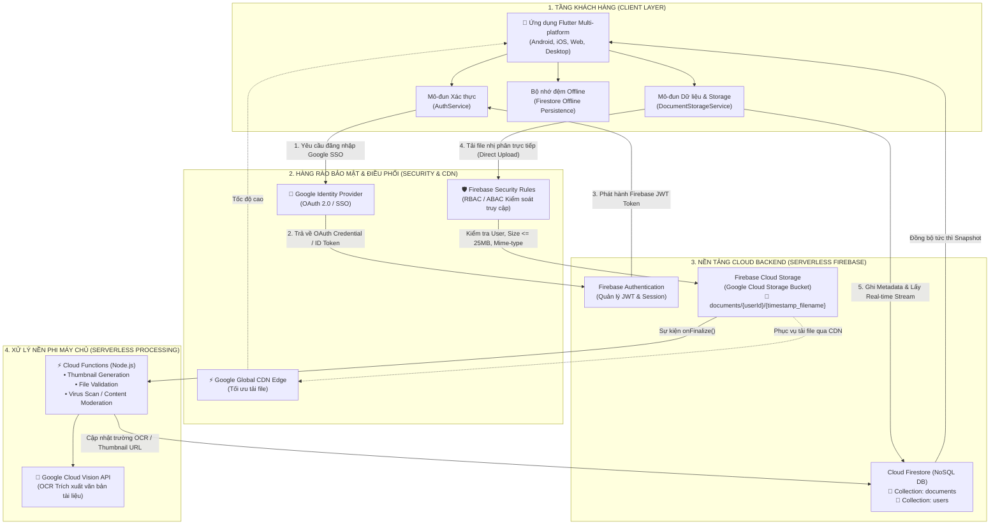
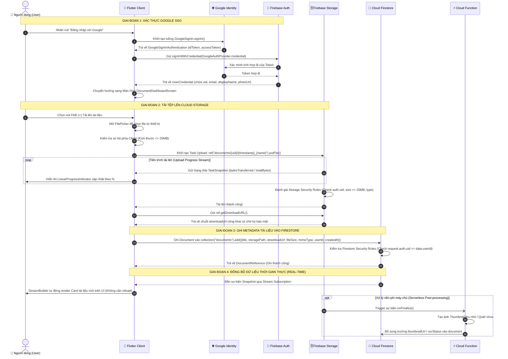

# BÁO CÁO PHÂN TÍCH VÀ THIẾT KẾ KIẾN TRÚC TÍCH HỢP CLOUD
## HỆ THỐNG QUẢN LÝ TÀI LIỆU DOANH NGHIỆP / HỌC TẬP (DOCUMENT MANAGEMENT SYSTEM - DMS)

---

- **Chức danh:** Cloud Solutions Architect & Full-stack Mobile Engineer (Flutter & Firebase)
- **Hệ thống:** Document Management System (DMS)
- **Ngày lập:** Tháng 10/2026
- **Trạng thái:** Bản thiết kế Kiến trúc & Triển khai (Production-ready Architecture)

---

## 1. TỔNG QUAN VÀ BỐI CẢNH DỰ ÁN (EXECUTIVE SUMMARY)

Hệ thống Quản lý Tài liệu (DMS) đóng vai trò huyết mạch trong việc lưu trữ, phân loại, tìm kiếm và cộng tác trên các tệp tài liệu số (PDF, DOCX, XLSX, hình ảnh, bài giảng, hồ sơ pháp lý). Trong giai đoạn đầu, hệ thống được xây dựng trên hạ tầng truyền thống (On-Premises / Local-First với máy chủ cục bộ hoặc thiết bị NAS). 

Khi quy mô người dùng và khối lượng dữ liệu gia tăng, mô hình truyền thống bộc lộ những hạn chế cố hữu:
1. Chi phí vận hành phần cứng và duy trì hạ tầng tăng vọt (CapEx & OpEx).
2. Tắc nghẽn băng thông và I/O đĩa cứng khi nhiều người dùng tải/tải lên tệp cùng lúc.
3. Rủi ro gián đoạn dịch vụ và mất mát dữ liệu do thiên tai, hỏng đĩa hoặc tấn công mã độc ransomware.
4. Rào cản truy cập từ xa đòi hỏi cấu hình mạng phức tạp (VPN, NAT, DDNS) với độ trễ cao.

Báo cáo này đưa ra phương án kỹ thuật toàn diện nhằm chuyển dịch kiến trúc hệ thống DMS từ hạ tầng vật lý nội bộ lên nền tảng **Public Cloud**, trực tiếp sử dụng hệ sinh thái **Google Cloud Platform (GCP) & Firebase** kết hợp với ứng dụng đa nền tảng **Flutter**.

---

## 2. PHÂN TÍCH CÁC THÀNH PHẦN CỐT LÕI HIỆN TẠI (ON-PREMISES / LEGACY ARCHITECTURE)

Hạ tầng hiện tại của hệ thống DMS truyền thống được cấu thành bởi 4 lớp chính:

```
+-------------------------------------------------------------------------+
|                        MÔ HÌNH HIỆN TẠI (ON-PREMISES)                   |
+-------------------------------------------------------------------------+
| [Client Tier]        Ứng dụng Desktop / Mobile / Web trong mạng LAN     |
|                             │  (HTTP / REST / Socket)                   |
|                             ▼                                           |
| [Application Tier]   Monolithic Backend Server (Node.js/Java/Python)   |
|                             │                                           |
|              ┌──────────────┴──────────────┐                            |
|              ▼                             ▼                            |
| [Database Tier - Metadata]       [Storage Tier - Binaries]              |
|  RDBMS Cục bộ (PostgreSQL/MySQL)   Local Hard Disk / SMB / NAS / SAN    |
+-------------------------------------------------------------------------+
```

### 2.1. Tầng Giao diện (Frontend Tier)
- Ứng dụng Desktop, Web nội bộ hoặc Mobile Client kết nối qua mạng nội bộ công ty (Local Area Network - LAN) hoặc qua kênh VPN được mã hóa.
- Phụ thuộc vào địa chỉ IP tĩnh hoặc máy chủ phân giải tên miền nội bộ (Internal DNS).

### 2.2. Tầng Nghiệp vụ (Backend API Tier)
- Máy chủ API Monolithic (viết bằng Spring Boot, ExpressJS hoặc Django) chịu trách nhiệm:
  * Tiếp nhận yêu cầu xác thực người dùng dựa trên cơ chế Session ID hoặc JWT lưu trữ trong bộ nhớ/Redis nội bộ.
  * Phân quyền truy cập theo danh sách điều khiển truy cập (Access Control List - ACL).
  * Đóng vai trò là "Proxy trung chuyển" (Reverse Proxy & I/O Pipeline): Khi người dùng tải file lên, backend phải đọc luồng byte (stream of bytes) qua giao thức HTTP multipart, lưu tạm vào buffer hoặc thư mục `/tmp`, sau đó ghi vào đĩa lưu trữ.

### 2.3. Tầng Cơ sở Dữ liệu Metadata (Database Tier)
- Hệ quản trị cơ sở dữ liệu quan hệ cục bộ (PostgreSQL, MySQL hoặc SQLite trên máy chủ).
- Lưu trữ các trường dữ liệu siêu dữ liệu (metadata) của tài liệu:
  * `id` (UUID / Auto increment): Mã định danh duy nhất của tài liệu.
  * `title` / `file_name`: Tên tài liệu hiển thị và tên tệp vật lý.
  * `storage_path`: Đường dẫn file tuyệt đối trên ổ cứng vật lý (`/var/data/dms/documents/2026/...`).
  * `file_size`: Dung lượng tính bằng bytes.
  * `mime_type`: Kiểu MIME (application/pdf, text/plain,...).
  * `file_hash`: Chuỗi mã băm SHA-256 kiểm tra tính toàn vẹn.
  * `owner_id`: Khóa ngoại tham chiếu bảng người dùng nội bộ.
  * `tags` / `category_id`: Phân loại danh mục, môn học, phòng ban.
  * `created_at`, `updated_at`: Dấu thời gian.

### 2.4. Tầng Lưu trữ Tệp Nhị phân (Binary File Storage Tier)
- Sử dụng trực tiếp ổ đĩa vật lý gắn trong máy chủ (Direct Attached Storage - DAS), ổ đĩa mạng chia sẻ (Network Attached Storage - NAS chạy SMB/NFS), hoặc hệ thống mạng lưu trữ diện rộng (Storage Area Network - SAN).
- Phân vùng thư mục theo thời gian hoặc ID người dùng để tránh vượt ngưỡng giới hạn số tệp trên một thư mục của hệ điều hành (Inodes exhaustion).

---

## 3. PHÂN TÍCH ĐIỂM NGHẼN & RỦI RO CỦA HẠ TẦNG TRUYỀN THỐNG

### 3.1. Giới hạn dung lượng đĩa vật lý (Storage Capacity Bottlenecks)
- **Vấn đề trần dung lượng (Storage Ceiling):** Ổ đĩa cứng cục bộ hoặc mảng đĩa RAID có dung lượng cố định (ví dụ: 10TB). Khi dung lượng chạm ngưỡng 85-90%, hệ thống đối mặt với nguy cơ sập dịch vụ (Crash do thiếu dung lượng đệm).
- **Chi phí nâng cấp gián đoạn (Disruptive Upgrades):** Việc mở rộng dung lượng đòi hỏi mua thêm ổ cứng mới, dừng hệ thống (downtime) để tháo lắp, cấu hình lại mảng RAID hoặc mua thiết bị SAN/NAS chuyên dụng đắt đỏ.
- **Hiện tượng phân mảnh và cạn kiệt Inode:** Trong hệ thống DMS với hàng trăm nghìn tài liệu nhỏ, số lượng Inode của hệ thống file (ext4, NTFS) cạn kiệt trước khi hết dung lượng byte thực tế.

### 3.2. Tắc nghẽn I/O khi đồng thời phục vụ nhiều tác vụ (I/O & Bandwidth Contention)
- **Nghẽn cổ chai tại Backend API Server:** Trong mô hình truyền thống, mọi luồng dữ liệu file đều phải đi qua Backend server trước khi chạm tới ổ cứng (`Client -> Backend RAM/Disk -> NAS`).
- **Disk I/O Thrashing:** Khi 50-100 người dùng đồng thời tải lên tệp lớn (PDF báo cáo hàng trăm trang, video bài giảng, bộ ảnh quét scan 300 DPI), đầu đọc đĩa cơ hoặc bus kết nối của ổ cứng bị quá tải (100% Active Time, I/O Wait tăng vọt).
- **Băng thông mạng nội bộ giới hạn (Local Link Saturation):** Card mạng Gigabit Ethernet (1Gbps) của máy chủ nhanh chóng bão hòa khi tổng băng thông tải xuống của các client đạt ngưỡng 125 MB/s, gây nghẽn toàn bộ các dịch vụ nội bộ khác.

### 3.3. Rủi ro mất mát dữ liệu & Thiếu cơ chế Disaster Recovery (DR)
- **Hỏng hóc phần cứng vật lý (Single Point of Failure - SPoF):** Mặc dù có cấu hình RAID 1 hoặc RAID 5, rủi ro hỏng đồng thời nhiều ổ cứng, chập cháy nguồn điện, sét đánh hoặc hỏng bộ điều khiển RAID (RAID Controller Failure) hoàn toàn có thể xảy ra.
- **Rủi ro mã độc tống tiền (Ransomware):** Nếu máy chủ hoặc ổ NAS bị xâm nhập qua mạng nội bộ, toàn bộ dữ liệu tài liệu có thể bị mã hóa hàng loạt do không có cơ chế lưu trữ bất biến (Object Versioning & WORM - Write Once, Read Many).
- **Thiếu giải pháp sao lưu ngoài vùng (Off-site Backup):** Việc sao lưu thủ công bằng băng từ (tape) hoặc ổ cứng di động thường xuyên bị bỏ quên, dẫn đến chỉ số RPO (Recovery Point Objective) lên tới nhiều ngày và RTO (Recovery Time Objective) kéo dài hàng tuần khi xảy ra thảm họa.

### 3.4. Khó khăn trong mở rộng quy mô & Trải nghiệm truy cập từ xa kém
- **Khó mở rộng ngang (Horizontal Scaling Complexity):** Để tăng số lượng máy chủ backend phục vụ tải, doanh nghiệp phải thiết lập hệ thống file phân tán phức tạp (như NFS, GlusterFS, Ceph) đi kèm với vấn đề File Lock Contention và Network Latency.
- **Phụ thuộc kết nối VPN chậm chạp:** Khi nhân viên, học sinh, giảng viên làm việc từ xa, họ phải kết nối qua VPN nội bộ. Tốc độ tải tài liệu phụ thuộc hoàn toàn vào đường truyền internet uplink khiêm tốn của văn phòng/trường học.

---

## 4. LỰA CHỌN MÔ HÌNH CLOUD & DỊCH VỤ MỤC TIÊU

### 4.1. Đề xuất mô hình: Public Cloud (Google Cloud Platform & Firebase Ecosystem)
Sau khi đánh giá các mô hình:
- **Private Cloud:** Chi phí đầu tư máy chủ ban đầu quá cao, đội ngũ bảo trì tốn kém, không giải quyết triệt để vấn đề phân phối CDN toàn cầu.
- **Hybrid Cloud:** Phù hợp với dữ liệu tối mật nhà nước nhưng tạo độ phức tạp vận hành không cần thiết cho ứng dụng DMS thông thường.
- **Public Cloud (Ưu tiên Firebase / Google Cloud):** Giải pháp tối ưu hàng đầu cho ứng dụng di động và web với khả năng tự động co giãn (Auto-scaling), không cần quản lý máy chủ (Serverless), chi phí thanh toán theo mức độ sử dụng (Pay-as-you-go), và tích hợp sâu sắc với framework **Flutter**.

### 4.2. Danh mục dịch vụ cốt lõi chỉ định

| Dịch vụ Cloud | Vai trò trong Hệ thống DMS | Đặc điểm kỹ thuật nổi bật |
| :--- | :--- | :--- |
| **Firebase Authentication** | Quản lý danh tính và Xác thực người dùng (Google SSO) | Hỗ trợ chuẩn OAuth 2.0 / OpenID Connect, JWT tokens tự động làm mới, tích hợp đăng nhập Google chỉ với 1 click, bảo vệ thông tin đăng nhập không lưu trên database tự quản. |
| **Cloud Firestore** | Cơ sở dữ liệu NoSQL lưu trữ Metadata tài liệu | Mô hình Document-Collection linh hoạt, hỗ trợ **Snapshot Streams thời gian thực (Real-time updates)**, tự động đồng bộ Offline Cache cho Flutter, nhân bản dữ liệu đa vùng (Multi-Region Replication) với độ sẵn sàng cao. |
| **Firebase Cloud Storage** *(Bọc Google Cloud Storage)* | Lưu trữ tệp nhị phân phân tán (PDF, DOCX, IMG) | Lưu trữ hướng đối tượng (Object Storage), độ bền bỉ dữ liệu đạt **99.999999999% (11 số 9)**, hỗ trợ cơ chế tải tệp ngắt quãng tiếp tục lại được (Resumable Uploads), tích hợp mạng phân phối CDN toàn cầu của Google. |
| **Cloud Functions for Firebase** *(Tùy chọn mở rộng)* | Tự động hóa xử lý tài liệu phi máy chủ (Serverless Pipelines) | Trigger tự động theo sự kiện `onFinalize()` của Storage: Tạo ảnh thu nhỏ (Thumbnail generation), nén tệp, quét virus, gọi Google Cloud Vision API để trích xuất văn bản OCR và đánh chỉ mục tìm kiếm full-text. |

---

## 5. THIẾT KẾ KIẾN TRÚC & LUỒNG DỮ LIỆU (DATA FLOW)

### 5.1. Sơ đồ Kiến trúc Hệ thống (System Architecture Diagram)

Dưới đây là sơ đồ kiến trúc tổng thể của hệ thống sau khi chuyển đổi lên nền tảng Google Cloud & Firebase:



> **Nguyên tắc thiết kế mấu chốt (Key Architectural Breakthrough):**
> Ứng dụng client tải/tải lên tệp **trực tiếp** với Cloud Storage thông qua Google SDK và bảo mật bằng Firebase Security Rules. Không còn sự hiện diện của "máy chủ trung gian" làm thắt nút cổ chai I/O như kiến trúc cũ.

---

### 5.2. Sơ đồ Tuần tự Chi tiết (Sequence Diagram)

Mô tả chi tiết luồng nghiệp vụ hoàn chỉnh từ khi người dùng đăng nhập bằng Google SSO đến khi tệp được tải lên Storage, lưu metadata vào Firestore và giao diện cập nhật thời gian thực.



---

## 6. MA TRẬN ĐÁNH GIÁ TÁC ĐỘNG (COMPARSION MATRIX)

Bảng so sánh đa chiều định lượng và định tính giữa hệ thống **Trước khi lên Cloud (On-Premises)** và **Sau khi lên Cloud (Firebase / GCP)**:

| Tiêu chí Đánh giá | Hạ tầng Cũ (On-Premises / Local Disk) | Hạ tầng Mới (Google Cloud & Firebase) | Đánh giá Tác động & Lợi ích |
| :--- | :--- | :--- | :--- |
| **1. BẢO MẬT (SECURITY)** | | | |
| *Cơ chế Xác thực (Auth)* | Tự quản lý cơ sở dữ liệu mật khẩu người dùng (nguy cơ lộ mật khẩu, thiếu mã hóa mạnh, không có MFA mặc định). | **Google SSO & Firebase Auth**: Xác thực đa yếu tố (MFA), chuẩn OAuth 2.0 / OpenID Connect, bảo mật cấp độ Google. | **Vượt trội**: Loại bỏ hoàn toàn rủi ro rò rỉ cơ sở dữ liệu mật khẩu nội bộ. |
| *Kiểm soát Truy cập (Access Control)* | Phân quyền tĩnh bằng thư mục OS (POSIX ACL) hoặc logic code lỏng lẻo trong monolithic backend. | **Firebase Security Rules**: Quy tắc khai báo linh hoạt, thực thi tại biên hạ tầng, kiểm tra `request.auth.uid`, dung lượng và loại file. | **Tuyệt đối an toàn**: Ngăn chặn tấn công Injection, leo thang đặc quyền từ gốc. |
| *Mã hóa Dữ liệu (Encryption)* | Thường lưu trữ dạng plain text trên đĩa. Không có mã hóa đường truyền nếu nội bộ không cấu hình chứng chỉ SSL/TLS. | **Mã hóa kép**: Mặc định mã hóa khi truyền (TLS 1.3) và mã hóa khi lưu trữ (AES-256 at rest) được Google quản lý tự động. | **Chuẩn Doanh nghiệp**: Tuân thủ chuẩn GDPR, HIPAA, ISO 27001. |
| *Nhật ký & Giám sát (Audit & Monitoring)* | Nhật ký ghi rải rác trên file log của server, dễ bị can thiệp, xóa sửa khi bị hack. | **Google Cloud Audit Logs & Cloud Logging**: Bất biến, theo dõi từng thao tác đọc/ghi file thời gian thực. | Khả năng truy vết lỗi và dấu hiệu bất thường 100%. |
| **2. CHI PHÍ (COST ANALYSIS)** | | | |
| *Mô hình Chi phí* | **CapEx (Vốn đầu tư ban đầu lớn)**: Mua sắm máy chủ, ổ cứng SAS/SATA, thiết bị mạng, hệ thống UPS, điều hòa phòng server. | **OpEx (Chi phí vận hành theo nhu cầu)**: Trả tiền theo đúng mức sử dụng thực tế (Pay-as-you-go). Không cần mua sắm trước. | Tối ưu hóa dòng tiền, khởi đầu dự án với chi phí ban đầu bằng 0 (Zero Upfront Cost). |
| *Gói Miễn phí (Free Tier)* | Không có. Mỗi GB lưu trữ đều tốn chi phí phần cứng. | **Firebase Spark Plan**: Miễn phí 1GB lưu trữ Firestore, 5GB Cloud Storage, 50,000 lượt đọc/ngày, không giới hạn user Google Auth. | Rất lý tưởng cho giai đoạn phát triển, thử nghiệm và các nhóm làm việc nhỏ. |
| *Chi phí Bảo trì & Vận hành* | Tốn nhân sự IT bảo trì, thay đĩa hỏng, bảo dưỡng phòng máy, tiền điện 24/7, chi phí điều hòa, chi phí khấu hao tài sản. | **Zero Maintenance Overhead**: Toàn bộ hạ tầng do Google vận hành. Kỹ sư chỉ tập trung phát triển tính năng sản phẩm. | Tiết kiệm ước tính **60% - 75%** tổng chi phí sở hữu (TCO) trong vòng 3 năm. |
| **3. HIỆU SUẤT & ĐỘ SẴN SÀNG** | | | |
| *Băng thông & Tốc độ tải* | Giới hạn bởi đường truyền vật lý tại văn phòng (thường < 100Mbps upload). Tải nhiều file đồng thời sẽ giật lag. | **Google Global Network & Cloud CDN**: Băng thông không giới hạn, phân phối qua các điểm Edge Point-of-Presence gần người dùng nhất. | Tốc độ tải tài liệu nhanh hơn gấp **5x - 10x**, đặc biệt đối với người dùng di động ngoài mạng LAN. |
| *Độ sẵn sàng (Availability SLA)* | Không có cam kết SLA. Thời gian chết (downtime) phụ thuộc vào sự cố điện lưới, đường truyền internet văn phòng. | Cam kết thỏa thuận mức dịch vụ **99.95% - 99.99% SLA**. Tự động chuyển đổi dự phòng (Auto Failover). | Giảm thiểu tối đa gián đoạn công việc của tổ chức. |
| *Khả năng Khôi phục Thảm họa (DR)* | Phụ thuộc vào việc sao chép thủ công. RPO có thể tính bằng ngày; RTO tính bằng ngày/tuần. | **Multi-Region Redundancy**: Dữ liệu tự động sao lưu dự phòng sang nhiều trung tâm dữ liệu độc lập về địa lý. RPO gần bằng 0. | Loại bỏ hoàn toàn nguy cơ mất dữ liệu vĩnh viễn do hỏng phần cứng hay thiên tai. |
| *Khả năng Mở rộng (Scalability)* | Giới hạn bởi số khe cắm ổ cứng và năng lực xử lý của máy chủ duy nhất (Vertical Scaling). | **Co giãn vô hạn (Infinite Elasticity)**: Lưu trữ hàng triệu tệp và hàng petabyte mà không cần thay đổi bất kỳ dòng code nào. | Sẵn sàng đáp ứng khi doanh nghiệp tăng trưởng đột biến. |

---

## 7. ĐỀ XUẤT LỘ TRÌNH CHUYỂN DỊCH (MIGRATION ROADMAP)

Để đảm bảo việc chuyển dịch hệ thống DMS diễn ra suôn sẻ và không làm gián đoạn công việc hiện tại, lộ trình 4 bước được khuyến nghị:

1. **Giai đoạn 1: Thiết lập Nền tảng Cloud (Cloud Foundation - Tuần 1):**
   - Đăng ký Firebase Project, kích hoạt Google Sign-In Provider.
   - Triển khai Cloud Firestore và Storage Bucket tại vùng địa lý tối ưu (ví dụ: `asia-southeast1` tại Singapore để có độ trễ thấp nhất cho Việt Nam).
   - Thiết lập bộ quy tắc bảo mật `firestore.rules` và `storage.rules`.

2. **Giai đoạn 2: Phát hành Bản Client Tích hợp Cloud (Tuần 2 - 3):**
   - Triển khai mã nguồn Flutter tích hợp `firebase_core`, `firebase_auth`, `cloud_firestore`, `firebase_storage`.
   - Cung cấp tính năng tải tệp lên đám mây song song với việc cho phép đồng bộ offline cục bộ.

3. **Giai đoạn 3: Di chuyển Dữ liệu Cũ (Data Migration Pipeline - Tuần 4):**
   - Viết kịch bản Node.js/Python di chuyển các tệp từ thư mục cục bộ/NAS lên Firebase Storage sử dụng Firebase Admin SDK.
   - Chuyển đổi siêu dữ liệu từ database SQL cục bộ sang các Document tương ứng trong Cloud Firestore.

4. **Giai đoạn 4: Đóng cổng Cũ & Tối ưu hóa (Cutover & Optimization - Tuần 5 trở đi):**
   - Chuyển toàn bộ người dùng sang ứng dụng mới.
   - Kích hoạt Cloud Functions cho OCR tìm kiếm toàn văn bản và tạo ảnh thu nhỏ tự động.
   - Tắt máy chủ lưu trữ vật lý cũ hoặc tái sử dụng cho mục đích lưu trữ lưu trữ nguội (Cold archive).

---
*Báo cáo được hoàn thiện và xác nhận bởi Cloud Solutions Architect.*
